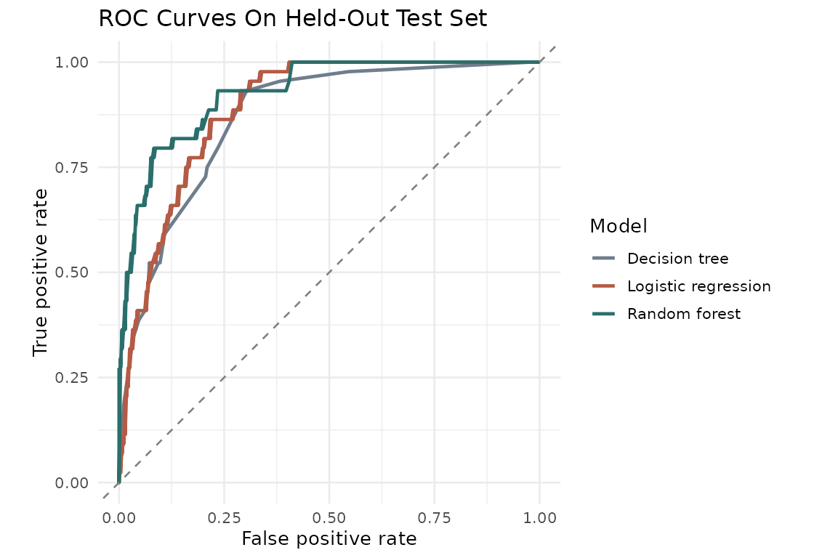
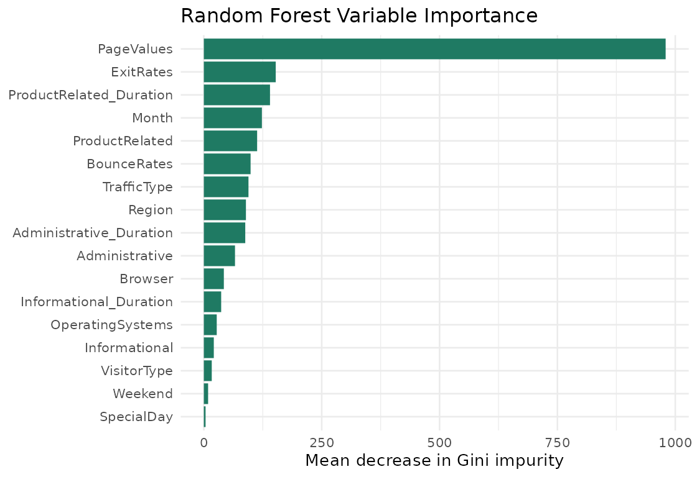

# Predicting Online Purchase Conversion From Session Behavior

Project Status: Academic analysis complete; not a deployed conversion system.

## Results at a Glance

Using 12,330 shopping sessions, this project compares three classifiers for purchase conversion. The cross-validation-selected random forest achieved **0.935 test ROC AUC**, **0.716 F1**, and **90.92% accuracy**.

| Model | Test ROC AUC | Purchase F1 | Accuracy | Purchase recall | Precision |
|---|---:|---:|---:|---:|---:|
| Logistic regression | 0.901 | 0.631 | 88.89% | 61.26% | 65.00% |
| Decision tree | 0.865 | 0.676 | 88.33% | 78.80% | 59.25% |
| Random forest | 0.935 | 0.716 | 90.92% | 73.82% | 69.46% |

Source: [saved test results](docs/model_test_results.csv) and [model summary](docs/model_summary.json). These are the repository's recorded results, not a new benchmark run. Thresholds were selected using validation F1: 0.25, 0.16, and 0.36 respectively. The workflow uses an 80/20 stratified split and three-fold training cross-validation.

Only about 15.47% of sessions convert, so accuracy alone is misleading. The decision tree has higher recall, while the random forest offers stronger AUC and F1 in these recorded results.

## Business Value

The analysis demonstrates how session behavior could help prioritize marketing or customer-support experiments. It measures predictive performance, **not incremental revenue or marketing uplift**. Any intervention requires prospective testing and features available at decision time.

## Visual Results





PageValues is the strongest recorded importance signal. Feature importance describes model behavior; it does not establish causation.

## Project Objective

This project builds predictive models in R to classify whether an online shopping session is likely to generate revenue based on session behavior and traffic attributes. The analysis compares logistic regression, decision tree, and random forest models, evaluates performance on a held-out test set, and translates the result into an executive summary and narrated presentation.

## Contributor

- Nikita Rogers

## Dataset

Dataset: UCI Online Shoppers Purchasing Intention dataset

Source: https://archive.ics.uci.edu/dataset/468/online+shoppers+purchasing+intention+dataset

Unit of observation: one online shopping session

Rows: 12,330

Prediction problem: binary classification

Response variable:

- `Purchase`: session generated revenue.
- `NoPurchase`: session did not generate revenue.

Predictors include:

- administrative page counts and duration
- informational page counts and duration
- product-related page counts and duration
- bounce rates
- exit rates
- page values
- special-day timing
- month
- operating system
- browser
- region
- traffic type
- visitor type
- weekend status

## Methods Used

- Exploratory data analysis
- Missing value check
- Categorical preprocessing
- Rare-category collapsing
- Stratified train/test splitting
- Stratified cross-validation
- Logistic regression
- Decision tree tuning
- Random forest tuning
- ROC AUC, accuracy, sensitivity, specificity, precision, and F1 evaluation
- Variable importance
- Non-technical executive summary

## Technologies

- R
- R Markdown
- ggplot2
- dplyr
- tidyr
- readr
- rpart
- randomForest
- pROC
- Git / GitHub
- Python for slide, narration, and packaging automation
- Edge TTS for disclosed narration generation

## Repository Structure

```text
.
├── README.md
├── report.Rmd
├── submission_checklist.md
├── executive_summary_outline.md
├── video_presentation_outline.md
├── data/
├── code/
├── figures/
├── slides/
└── docs/
```

## How To Run

Prerequisites: R, plus RStudio (recommended) or Pandoc for HTML rendering. Package versions are not locked; exact numerical reproducibility across environments is not guaranteed.

1. Clone the repository and enter its root:
   ```bash
   git clone https://github.com/nikitarogers333/ads-predictive-modeling-final.git
   cd ads-predictive-modeling-final
   ```
2. In R, install the report dependencies:
   ```r
   install.packages(c("rmarkdown", "readr", "dplyr", "tidyr", "ggplot2",
                      "randomForest", "rpart", "pROC", "knitr", "jsonlite",
                      "scales", "tibble"), repos = "https://cloud.r-project.org")
   ```
3. Open `report.Rmd` in RStudio and knit to HTML, or use the command below from the repository root. Rendering retrains models and updates generated figures and summaries.

Command line option:

```bash
Rscript -e "rmarkdown::render('report.Rmd', output_file='Report-Team1.html')"
```

The report downloads the UCI dataset automatically if `data/online_shoppers_intention.csv` does not exist.

## Limitations and Next Steps

- **Prediction timing:** PageValues and full-session aggregates may be unavailable before an intervention. Audit feature timestamps and compare a model without PageValues before claiming real-time usefulness.
- **Generalization:** A random held-out split from one dataset does not demonstrate performance across other stores or future periods. Add temporal and external validation.
- **Preprocessing:** Rare-category collapsing is currently performed before splitting. Fit category mappings on training data only in a future revision.
- **Decision costs:** F1-based thresholds do not optimize business profit. Evaluate calibration and choose thresholds using intervention costs and expected value.
- **Interpretation:** Gini importance can favor some feature types; supplement it with held-out permutation importance.
- **Reproducibility:** Capture a tested R environment with `renv.lock` and session information; add an automated report-render check.
- **Business validation:** Use a controlled experiment to measure incremental conversions or revenue before deployment.

## Deliverables

- `Report-Team1.html`
- `Executive_Summary-Team1.pptx`
- `Video_Presentation-Team1.mp4`
- `video_narration.mp3`
- `video_script.md`
- GitHub repository with this README

## AI Use Disclosure

AI-assisted tools were used to help organize the report structure, draft explanatory language, create reproducible code scaffolding, and prepare presentation materials. AI was used as a support tool and is disclosed in the report because the assignment requires explicit attribution. The repository includes the R Markdown source, code appendix, generated outputs, and interpretation needed to inspect the analysis independently.

## License

For academic use only unless otherwise specified.
